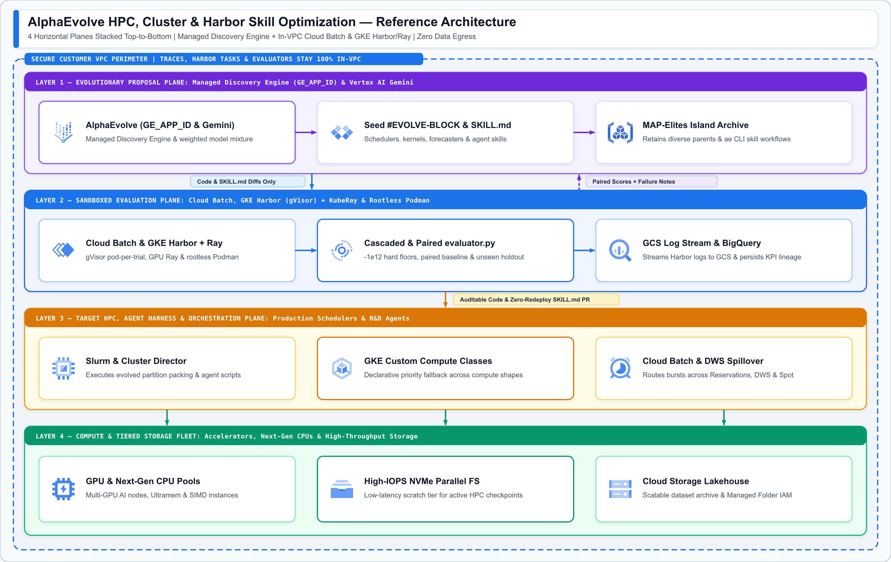
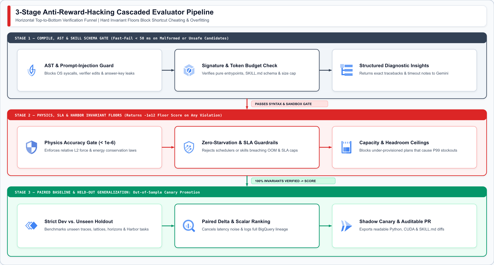
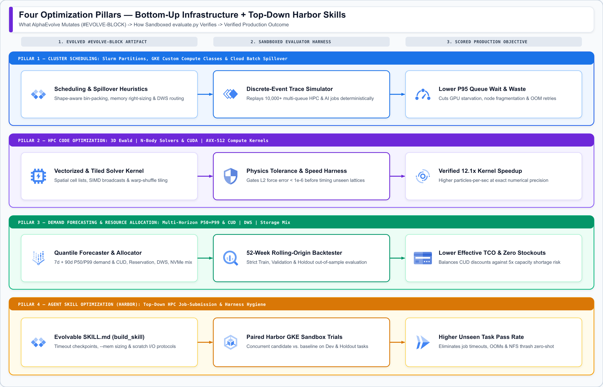
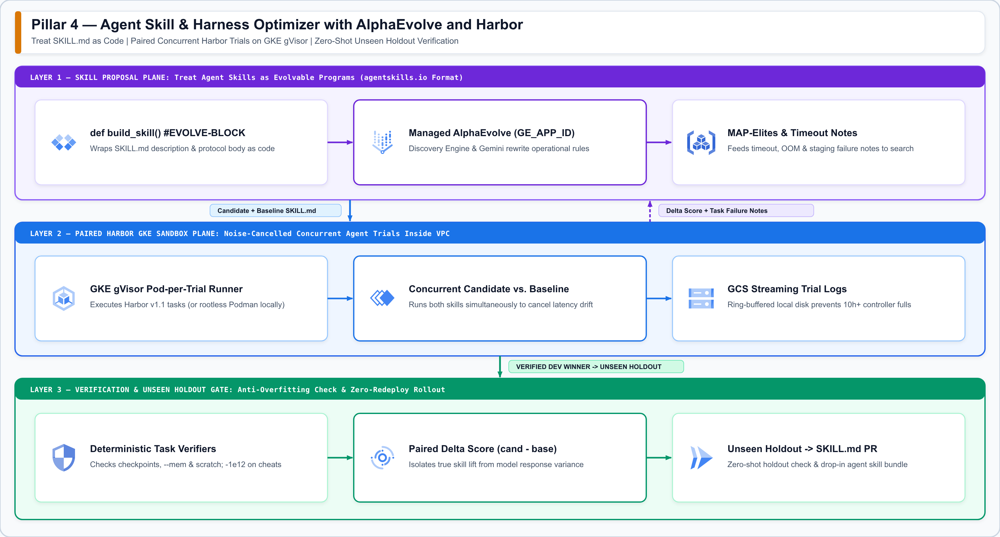
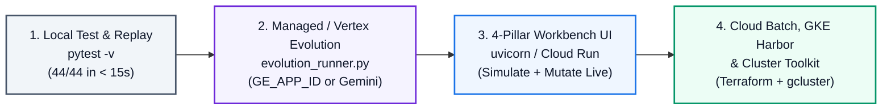
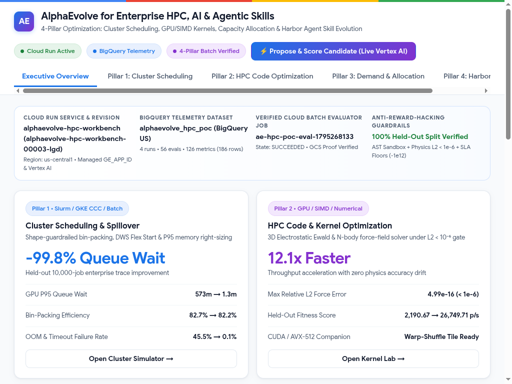
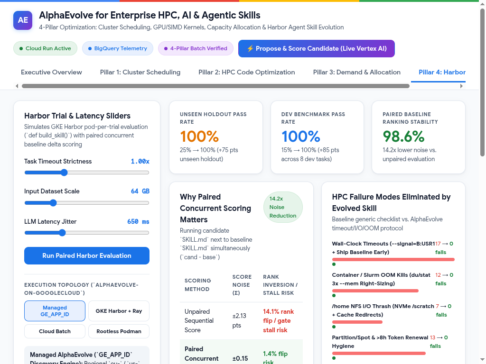

# Autonomous HPC & Cluster Optimization with AlphaEvolve on Google Cloud

> **Evolve auditable cluster schedulers, GPU/SIMD compute kernels, capacity-allocation portfolios, and Harbor-verified agent `SKILL.md` harnesses inside your VPC using Managed AlphaEvolve (`GE_APP_ID` Discovery Engine) & Vertex AI Gemini, Google Cloud Batch, GKE Sandbox (`gVisor`) + KubeRay, and Slurm / Cluster Director.**

[](./LICENSE)
[](./pyproject.toml)
[](./tests)
[](./docs/GCP_DEPLOYMENT_GUIDE.md)
[](./infra)

<p align="center">
  
</p>

---

## 1. The Problem: Why Static HPC Platforms & Agent Skills Lose 30%–45% Efficiency

Enterprise AI and scientific R&D clusters face **two compounding bottlenecks**: *bottom-up* infrastructure rigidity (Pillars 1–3) and *top-down* workload-submission errors by human scripts and coding agents (Pillar 4):

| Bottleneck Domain | Static Operational Pattern | Compounding Cost & Velocity Penalty |
| :--- | :--- | :--- |
| **1. Cluster Scheduling** *(Bottom-Up)* | Fixed Slurm fairshare & first-fit rules place small `2–8 vCPU` jobs onto `64+ vCPU` Ultramem/GPU nodes without memory right-sizing | Multi-hour GPU queue starvation, stranded high-memory nodes, and OOM/timeout retry storms |
| **2. HPC Solvers & Kernels** *(Bottom-Up)* | Un-tiled $O(N^2)$ pairwise loops, AoS cache misses, and unvectorized inner kernels | `3x–12x` lower throughput per GPU/CPU hour on recurring simulation workloads |
| **3. Demand & Allocation** *(Bottom-Up)* | Spreadsheets with static `+20%` buffers and rigid `50%` commitment splits | Over-paying for On-Demand peaks or suffering costly P99 capacity stockouts |
| **4. Agent `SKILL.md` Harnesses** *(Top-Down)* | Generic hand-written skills (*"write clean code and submit"*) omit checkpointing, header-based `--mem` sizing, and `/scratch` staging | Wall-clock timeouts, `OUT_OF_MEMORY` crashes, shared `/home` NFS stalls, and `>8h` token expiry |

---

## 2. Why AlphaEvolve Matters: White-Box Code & Skill Evolution Inside Your VPC

Instead of placing a black-box neural policy in the live control loop of `slurmctld` or `kube-scheduler`, **AlphaEvolve** evolves **readable, diffable `# EVOLVE-BLOCK` source code and `agentskills.io` `SKILL.md` protocols offline** against deterministic trace replays, physics invariants, rolling-origin backtests, and paired **Harbor** container trials:

<p align="center">
  
</p>

- **100% VPC Data Isolation (`alphaevolve-on-googlecloud` Compatible)**: Proprietary job traces, molecular conformations, capacity telemetry, and Harbor tasks stay strictly inside your VPC (`Cloud Batch`, `GKE gVisor`, `Cloud Storage`, `BigQuery`, or `Rootless Podman`). Only compact code/`SKILL.md` diffs and scalar diagnostics cross the Managed Discovery Engine (`GE_APP_ID`) or Vertex AI boundary.
- **Zero Reward Hacking (`-1e12` Hard Floors)**: Every candidate passes an AST / prompt-injection sandbox check (Stage 1) and strict domain invariants—relative L2 force error `< 1e-6`, `0` starved jobs, P99 headroom floors, and `< 8,000`-char skill budgets (Stage 2)—before held-out generalization (Stage 3).
- **Noise-Cancelled Paired Harbor Scoring**: Pillar 4 runs candidate and baseline skills concurrently on the same Harbor tasks (`delta = score(cand) - score(base)`), canceling LLM response-latency drift while streaming logs directly to Cloud Storage so `10h+` searches never fill controller disks.

---

## 3. Four Optimization Pillars & Validated Benchmark Results

<p align="center">
  
</p>

### Held-Out Benchmark Summary (`Vertex AI gemini-2.5-flash` Live Evolutionary Runs, 52 Total Candidates)

| Pillar | Primary Objective | Seed Baseline | AlphaEvolve Winner | Held-Out Gain | Deep-Dive Guide |
| :--- | :--- | :---: | :---: | :---: | :--- |
| **1. Cluster Scheduling** | Composite Queue + Cost + Waste (`overall_score`) | `-344.87` *(Fairshare: `-174.82`)* | **`-63.61`** *(Gen 10)* | **`+81.55%`** | [`CLUSTER_SCHEDULING.md`](./docs/CLUSTER_SCHEDULING.md) |
| **2. HPC Code Optimization** | 3D Shifted Ewald Throughput (`particles/sec`) | `2,190.67` | **`26,749.71`** *(Gen 12)* | **`12.1x` (`+1,121.07%`)** | [`HPC_KERNEL_OPTIMIZATION.md`](./docs/HPC_KERNEL_OPTIMIZATION.md) |
| **3. Demand & Allocation** | 52-Week Risk-Adjusted Backtest (`overall_score`) | `-4,812.67` | **`-3,329.25`** *(Gen 12)* | **`+30.82%`** | [`DEMAND_FORECASTING_ALLOCATION.md`](./docs/DEMAND_FORECASTING_ALLOCATION.md) |
| **4. Agent Skill Optimizer (Harbor)** | Unseen Holdout Pass Rate & Paired Delta | `25.0%` (`0.00 pts`) | **`100.0%` (`+76.25 pts`)** *(Gen 4)* | **`+75.0 pts` (`+300.0%`)** | [`AGENT_SKILL_OPTIMIZATION_HARBOR.md`](./docs/AGENT_SKILL_OPTIMIZATION_HARBOR.md) |

### Key Held-Out KPI Breakdown Across All 4 Pillars

| Pillar | Verified Held-Out KPI | Baseline (`Seed`) | Evolved (`AlphaEvolve`) | Verified Impact / Guardrail |
| :--- | :--- | :---: | :---: | :--- |
| **Pillar 1** | GPU Training P95 Queue Wait | `572.76 min` (`9.55 hrs`) | **`1.25 min`** | **`-99.8%`** via shape guardrails + DWS Flex Start spillover |
| **Pillar 1** | OOM + Timeout + Preemption Rate | `45.55%` | **`0.05%`** | **`-99.9%`**; Avg job cost **`$4.08 → $2.39`** (**`-41.3%`**) |
| **Pillar 2** | Conformation Batch Latency | `701.16 ms` | **`57.42 ms`** | **`-91.8%`** (`12/13` inaccurate mutations rejected at `-1e12`) |
| **Pillar 2** | Relative L2 Force Error & Energy Drift | `1.89e-16` / `4.38e-9` | **`4.99e-16` / `4.38e-9`** | Strictly below `< 1e-6` force & `< 1e-4` Verlet drift gates |
| **Pillar 3** | 12-Week Risk-Adjusted Total TCO | `$4,697.70K` | **`$3,261.19K`** | **`-30.6%`** (`$1,436.5K` saved on held-out Weeks 40–51) |
| **Pillar 3** | 5x Stockout Penalty & P99 Breach Rate | `$1,044.00K` (`54.76%`) | **`$21.73K` (`5.36%`)** | **`-97.9%`** penalty; blended WMAPE **`13.53% → 8.01%`** (`-40.8%`) |
| **Pillar 4** | Harbor Dev (`8` tasks) & Holdout (`4` unseen) Pass Rate | `15.0%` Dev / `25.0%` Holdout | **`100.0%` Dev / `100.0%` Holdout** | Eliminates **`15 → 0`** unseen holdout timeouts, OOMs & token failures |
| **Pillar 4** | Latency-Wave Score Std (Raw vs. Paired Delta) | `1.984 pts` *(unpaired: `2.608`)* | **`0.000 pts`** | Concurrent baseline co-execution cancels model latency waves |

<p align="center">
  
</p>

> **Full Lineage, Diffs & Exported `SKILL.md`**: Inspect [`pillars/results/benchmark_summary.json`](./pillars/results/benchmark_summary.json) and the ready-to-install evolved skill at [`pillars/agent_skill_optimization/evolved_skill/SKILL.md`](./pillars/agent_skill_optimization/evolved_skill/SKILL.md).

---

## 4. Managed Execution with `alphaevolve-on-googlecloud`

This repository integrates natively with [`Google-Cloud-AI/alphaevolve-on-googlecloud`](https://github.com/Google-Cloud-AI/alphaevolve-on-googlecloud) via [`pillars/common/managed_ae_client.py`](./pillars/common/managed_ae_client.py):

| Capability | Supported Configuration | Purpose |
| :--- | :--- | :--- |
| **Managed Discovery Engine (`GE_APP_ID`)** | `discoveryengine.googleapis.com` (`global`, `us-`, `eu-`) | Connects `:acquirePrograms` / `:submitProgramsEvaluations` to Gemini Enterprise (`GE_APP_ID`), falling back cleanly to Vertex AI Gemini or offline replay |
| **6 Self-Service `ae` Coding Skills** | `uv tool install "git+https://github.com/Google-Cloud-AI/alphaevolve-on-googlecloud.git#subdirectory=skills"` + `ae skills install` | Guides developers end-to-end across experiment design, runner, monitor, post-experiment & consultant workflows |
| **GKE `gVisor` Harbor + KubeRay Pool** | [`infra/gke-harbor-ray/harbor-skill-optimizer-gke.yaml`](./infra/gke-harbor-ray/harbor-skill-optimizer-gke.yaml) | Pod-per-trial `gVisor` Harbor isolation + autoscaling GPU Ray workers + GCS trial-log streaming |
| **Rootless Podman (`subuids`)** | `sudo usermod --add-subuids 100000-165535 $USER` | Zero-privilege local sandbox execution on shared multi-tenant HPC login/workbench nodes |

---

## 5. Quickstart: Evaluate, Evolve & Deploy



### A. Run Evaluators & Anti-Reward-Hacking Test Suite Locally

```bash
python3 -m venv .venv && source .venv/bin/activate
pip install -r requirements.txt

# Run all 44 unit, AST/prompt-injection sabotage, Harbor v1.1 & holdout split tests
pytest -v

# Run deterministic offline evolutionary replay across all 4 pillars in seconds
python3 -m pillars.common.evolution_runner --mode replay --pillar all
```

### B. Launch the 4-Pillar Interactive Workbench UI (Local, Docker, or Cloud Run)

<p align="center">
  
</p>

<p align="center">
  
</p>

```bash
# Run locally with FastAPI + Uvicorn
export GCP_PROJECT_ID="<YOUR_GCP_PROJECT_ID>"
export GCP_REGION="us-central1"
uvicorn app.server:app --host 0.0.0.0 --port 8080

# Or build & run via Docker
docker build -t alphaevolve-hpc-workbench .
docker run --rm -p 8080:8080 -e GCP_PROJECT_ID="<YOUR_GCP_PROJECT_ID>" alphaevolve-hpc-workbench
```

### C. Run Live Evolutionary Search (Managed `GE_APP_ID` or Vertex AI Gemini)

```bash
export GCP_PROJECT_ID="<YOUR_GCP_PROJECT_ID>"
export GCP_REGION="us-central1"
# Optional: export GE_APP_ID="<YOUR_GEMINI_ENTERPRISE_ENGINE_ID>" for Managed Discovery Engine

python3 -m pillars.common.evolution_runner --mode live --pillar all --candidates 14
```

### D. Deploy Full Google Cloud PoC, GKE Harbor/KubeRay & Cluster Toolkit

See [**`docs/GCP_DEPLOYMENT_GUIDE.md`**](./docs/GCP_DEPLOYMENT_GUIDE.md) for complete instructions:

```bash
export GCP_PROJECT_ID="<YOUR_GCP_PROJECT_ID>"
export GCP_REGION="us-central1"

# 1. Provision GCS archive, BigQuery dataset, Artifact Registry & IAM via Terraform
terraform -chdir=infra/terraform init
terraform -chdir=infra/terraform apply -var="project_id=${GCP_PROJECT_ID}" -var="region=${GCP_REGION}"

# 2. Deploy 4-Pillar Cloud Run Workbench, seed BigQuery & run Cloud Batch evaluator job
./scripts/deploy_cloud_run.sh
python3 scripts/seed_bigquery.py
python3 scripts/submit_cloud_batch_job.py

# 3. Validate GKE Sandbox (gVisor) Harbor + KubeRay manifests
kubectl apply --dry-run=client -f infra/gke-harbor-ray/harbor-skill-optimizer-gke.yaml
```

---

## 6. Repository Structure

```text
├── assets/                                  # Pure-vector horizontal SVG & 2x Retina PNG diagrams + UI previews
├── app/                                     # FastAPI backend + 4-Pillar Interactive HTML5 Workbench
├── docs/
│   ├── CLUSTER_SCHEDULING.md                # Pillar 1: Slurm, GKE CCC & Cloud Batch scheduling evolution
│   ├── HPC_KERNEL_OPTIMIZATION.md           # Pillar 2: 3D Ewald / SIMD / CUDA kernel optimization & physics gates
│   ├── DEMAND_FORECASTING_ALLOCATION.md     # Pillar 3: Multi-horizon P50/P99 forecasting & CUD/DWS/Storage mix
│   ├── AGENT_SKILL_OPTIMIZATION_HARBOR.md   # Pillar 4: AlphaEvolve + Harbor SKILL.md optimizer & GE_APP_ID guide
│   └── GCP_DEPLOYMENT_GUIDE.md              # Terraform, Cloud Run, Batch, GKE Harbor/Ray, Podman & gcluster
├── infra/
│   ├── cluster-toolkit/                     # Declarative gcluster YAML blueprints (AlphaEvolve Batch, Slurm DWS, GKE CCC)
│   ├── gke-harbor-ray/                      # GKE Sandbox (gVisor) Harbor pod-per-trial + KubeRay + GCS log streaming
│   └── terraform/                           # Modular Terraform for GCS, BigQuery, Artifact Registry, IAM & Cloud Run
├── pillars/
│   ├── common/                              # MAP-Elites runner, Managed GE_APP_ID adapter, AST sandbox & Gemini client
│   ├── cluster_scheduling/                  # Pillar 1 seed (#EVOLVE-BLOCK), 10k-job trace simulator & evaluator
│   ├── hpc_code_optimization/               # Pillar 2 seed (#EVOLVE-BLOCK), physics reference & CUDA/SIMD kernel
│   ├── demand_forecasting/                  # Pillar 3 seed (#EVOLVE-BLOCK), 52-week telemetry & backtester
│   ├── agent_skill_optimization/            # Pillar 4 build_skill() (#EVOLVE-BLOCK), 12 Harbor v1.1 tasks & evolved SKILL.md
│   └── results/                             # Verified 4-pillar live evolutionary JSON summaries & diffs
├── scripts/                                 # Cloud Run deployer, 4-pillar BigQuery seeder & Cloud Batch job runner
└── tests/                                   # Automated pytest suite (44 tests) verifying evaluators, gates & schemas
```

---

## License

Licensed under the [Apache License 2.0](./LICENSE).
