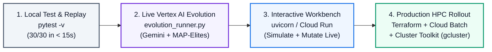

# Autonomous HPC & Cluster Optimization with AlphaEvolve on Google Cloud

> **Evolve auditable cluster schedulers, scientific compute kernels, and capacity-allocation policies inside your VPC using Vertex AI Gemini, Google Cloud Batch, Slurm / Cluster Director, and GKE Custom Compute Classes.**

[](./LICENSE)
[](./pyproject.toml)
[](./tests)
[](./docs/GCP_DEPLOYMENT_GUIDE.md)
[](./infra)

<p align="center">
  
</p>

---

## 1. The Problem: Why Static HPC Platforms Lose 30%–45% Efficiency

Enterprise AI and scientific R&D clusters run heterogeneous workloads—interactive notebooks/IDEs, distributed multi-GPU training, high-memory genomics, and massive batch arrays—where static configurations hit an operational ceiling:

| Bottleneck Domain | Static Operational Pattern | Compounding Cost & Velocity Penalty |
| :--- | :--- | :--- |
| **1. Cluster Scheduling** | Fixed Slurm fairshare & first-fit rules place small `2–8 vCPU` jobs onto `64+ vCPU` Ultramem/GPU nodes without memory right-sizing | Multi-hour GPU queue starvation, stranded high-memory nodes, and OOM/timeout retry storms |
| **2. HPC Solvers & Kernels** | Un-tiled $O(N^2)$ pairwise loops, AoS cache misses, and unvectorized inner kernels | `3x–12x` lower throughput per GPU/CPU hour on recurring simulation workloads |
| **3. Demand & Allocation** | Spreadsheets with static `+20%` buffers and rigid `50%` commitment splits | Over-paying for On-Demand peaks or suffering costly P99 capacity stockouts |

---

## 2. Why AlphaEvolve Matters: White-Box Code Evolution Inside Your VPC

Instead of placing a black-box neural agent in the live control loop of `slurmctld` or `kube-scheduler`, **AlphaEvolve** evolves **readable, diffable `# EVOLVE-BLOCK` source code offline** against deterministic trace replays, physics invariants, and rolling-origin backtests:

<p align="center">
  
</p>

- **100% VPC Data Isolation**: Proprietary job traces, molecular conformations, and capacity telemetry never leave your VPC (`Cloud Storage` + `BigQuery` + `Cloud Batch`). Only compact source diffs and scalar diagnostics flow to the Vertex AI Gemini mutator.
- **Zero Reward Hacking (`-1e12` Hard Floors)**: Every candidate passes an AST sandbox check (Stage 1) and strict domain invariants—relative L2 force error `< 1e-6`, `0` starved jobs, and P99 headroom floors (Stage 2)—before held-out hill-climbing (Stage 3).
- **Human-Auditable Canary Rollout**: Winning candidates graduate as clean Python / CUDA / YAML pull requests validated in shadow mode before production promotion.

---

## 3. Three Optimization Pillars & Validated Benchmark Results

<p align="center">
  
</p>

### Held-Out Benchmark Summary (`Vertex AI gemini-2.5-flash` Live Evolutionary Runs, 39 Candidates)

| Pillar | Primary Objective | Seed Baseline | AlphaEvolve Winner | Held-Out Gain | Deep-Dive Guide |
| :--- | :--- | :---: | :---: | :---: | :--- |
| **1. Cluster Scheduling** | Composite Queue + Cost + Waste Score (`overall_score`) | `-344.87` *(Tuned Fairshare: `-174.82`)* | **`-63.61`** *(Gen 10)* | **`+81.55%`** | [`CLUSTER_SCHEDULING.md`](./docs/CLUSTER_SCHEDULING.md) |
| **2. HPC Code Optimization** | 3D Shifted Ewald Force Throughput (`particles/sec`) | `2,190.67` | **`26,749.71`** *(Gen 12)* | **`12.1x` (`+1,121.07%`)** | [`HPC_KERNEL_OPTIMIZATION.md`](./docs/HPC_KERNEL_OPTIMIZATION.md) |
| **3. Demand & Allocation** | Risk-Adjusted 52-Week Backtest Score (`overall_score`) | `-4,812.67` | **`-3,329.25`** *(Gen 12)* | **`+30.82%`** | [`DEMAND_FORECASTING_ALLOCATION.md`](./docs/DEMAND_FORECASTING_ALLOCATION.md) |

### Key Held-Out KPI Breakdown Across All 3 Pillars

| Pillar | Verified Held-Out KPI | Baseline (`Seed`) | Evolved (`AlphaEvolve`) | Verified Impact / Guardrail |
| :--- | :--- | :---: | :---: | :--- |
| **Pillar 1** | GPU Training P95 Queue Wait | `572.76 min` (`9.55 hrs`) | **`1.25 min`** | **`-99.8%`** via shape guardrails + DWS Flex Start spillover |
| **Pillar 1** | OOM + Timeout + Preemption Rate | `45.55%` | **`0.05%`** | **`-99.9%`** via historical P95 memory/runtime right-sizing |
| **Pillar 1** | Avg Compute + Storage Cost / Job | `$4.08` | **`$2.39`** | **`-41.3%`** (`Interactive IDE P95 = 8.0 s < 120 s` SLA floor) |
| **Pillar 2** | Conformation Batch Latency | `701.16 ms` | **`57.42 ms`** | **`-91.8%`** (`12/13` inaccurate candidates rejected at `-1e12`) |
| **Pillar 2** | Relative L2 Force Error & Energy Drift | `1.89e-16` / `4.38e-9` | **`4.99e-16` / `4.38e-9`** | Strictly below `< 1e-6` force & `< 1e-4` Verlet drift gates |
| **Pillar 3** | 12-Week Risk-Adjusted Total TCO | `$4,697.70K` | **`$3,261.19K`** | **`-30.6%`** (`$1,436.5K` saved on held-out Weeks 40–51) |
| **Pillar 3** | 5x Stockout Penalty & P99 Breach Rate | `$1,044.00K` (`54.76%`) | **`$21.73K` (`5.36%`)** | **`-97.9%`** penalty; blended WMAPE cut **`13.53% → 8.01%`** (`-40.8%`) |

> **Full Lineage & Diffs**: Inspect [`pillars/results/benchmark_summary.json`](./pillars/results/benchmark_summary.json) and per-pillar JSON artifacts in [`pillars/results/`](./pillars/results).

---

## 4. Quickstart: Evaluate, Evolve & Deploy



### A. Run Evaluators & Anti-Reward-Hacking Test Suite Locally

```bash
python3 -m venv .venv && source .venv/bin/activate
pip install -r requirements.txt

# Run all 30 unit, sandbox, anti-reward-hacking & holdout split tests
pytest -v

# Run deterministic offline evolutionary replay in seconds (no cloud credentials needed)
python3 -m pillars.common.evolution_runner --mode replay --pillar all
```

### B. Launch the Interactive Workbench UI (Local, Docker, or Cloud Run)

<p align="center">
  
</p>

```bash
# Run locally with FastAPI + Uvicorn
export GCP_PROJECT_ID="<YOUR_GCP_PROJECT_ID>"
export GCP_REGION="us-central1"
uvicorn app.server:app --host 0.0.0.0 --port 8080

# Or build & run via Docker
docker build -t alphaevolve-hpc-workbench .
docker run --rm -p 8080:8080 -e GCP_PROJECT_ID="<YOUR_GCP_PROJECT_ID>" alphaevolve-hpc-workbench
```

### C. Run Live Vertex AI Evolutionary Search

```bash
export GCP_PROJECT_ID="<YOUR_GCP_PROJECT_ID>"
export GCP_REGION="us-central1"

python3 -m pillars.common.evolution_runner --mode live --pillar all --candidates 14
```

### D. Deploy Full Google Cloud PoC & Cluster Toolkit Blueprints

See [**`docs/GCP_DEPLOYMENT_GUIDE.md`**](./docs/GCP_DEPLOYMENT_GUIDE.md) for full instructions:

```bash
export GCP_PROJECT_ID="<YOUR_GCP_PROJECT_ID>"
export GCP_REGION="us-central1"

# 1. Provision GCS archive, BigQuery dataset, Artifact Registry & IAM via Terraform
terraform -chdir=infra/terraform init
terraform -chdir=infra/terraform apply -var="project_id=${GCP_PROJECT_ID}" -var="region=${GCP_REGION}"

# 2. Deploy Cloud Run Workbench, seed BigQuery & run Cloud Batch evaluator validation
./scripts/deploy_cloud_run.sh
python3 scripts/seed_bigquery.py
python3 scripts/submit_cloud_batch_job.py
```

---

## 5. Repository Structure

```text
├── assets/                                  # High-res horizontal SVG & 2x Retina PNG architecture diagrams
├── app/                                     # FastAPI backend + Interactive HTML5 Workbench (Overview + Pillars 1–3)
├── docs/
│   ├── CLUSTER_SCHEDULING.md                # Pillar 1: Slurm, GKE CCC & Cloud Batch scheduling evolution
│   ├── HPC_KERNEL_OPTIMIZATION.md           # Pillar 2: 3D Ewald / SIMD / CUDA kernel optimization & physics gates
│   ├── DEMAND_FORECASTING_ALLOCATION.md     # Pillar 3: Multi-horizon P50/P99 forecasting & CUD/DWS/Storage mix
│   └── GCP_DEPLOYMENT_GUIDE.md              # Terraform, Cloud Run, BigQuery, Cloud Batch & gcluster deployment
├── infra/
│   ├── cluster-toolkit/                     # Declarative gcluster YAML blueprints (AlphaEvolve Batch, Slurm DWS, GKE CCC)
│   └── terraform/                           # Modular Terraform for GCS, BigQuery, Artifact Registry, IAM & Cloud Run
├── pillars/
│   ├── common/                              # MAP-Elites runner, AST sandbox & Vertex AI Gemini client
│   ├── cluster_scheduling/                  # Pillar 1 seed (#EVOLVE-BLOCK), 10k-job trace simulator & evaluator
│   ├── hpc_code_optimization/               # Pillar 2 seed (#EVOLVE-BLOCK), physics reference & CUDA/SIMD kernel
│   ├── demand_forecasting/                  # Pillar 3 seed (#EVOLVE-BLOCK), 52-week telemetry & backtester
│   └── results/                             # Verified live evolutionary benchmark JSON summaries & diffs
├── scripts/                                 # Cloud Run deployer, BigQuery seeder & Cloud Batch job runner
└── tests/                                   # Automated pytest suite (30 tests) verifying evaluators, gates & schemas
```

---

## License

Licensed under the [Apache License 2.0](./LICENSE).
