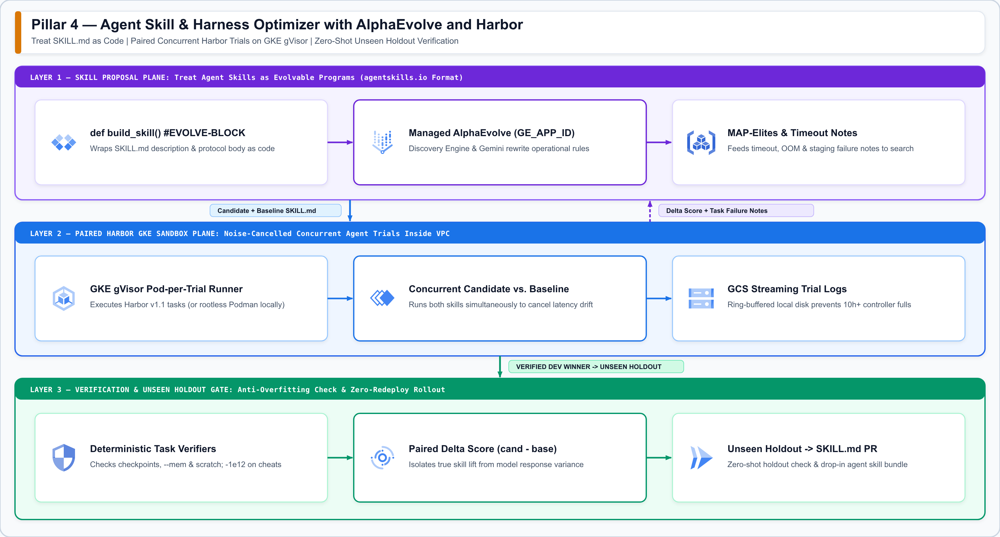
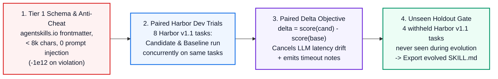
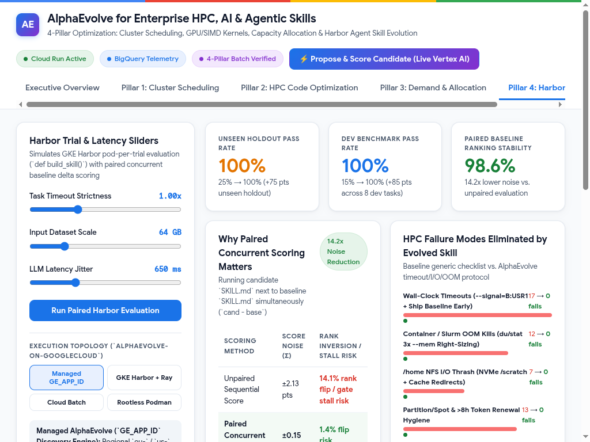

# Pillar 4 — Agent Skill & Harness Optimization with AlphaEvolve and Harbor

> **Evolving high-reliability `SKILL.md` operational protocols (`agentskills.io`) for AI coding and HPC job-submission agents using AlphaEvolve, Harbor, and paired concurrent baseline evaluation.**

<p align="center">
  
</p>

---

## 1. Why Hand-Written `SKILL.md` Instructions Plateau on HPC Workloads

While **Pillars 1–3** optimize *bottom-up* cluster infrastructure, solvers, and capacity portfolios, enterprise HPC platforms also suffer *top-down* job-submission pathologies when researchers or AI coding agents author Slurm, Kubernetes, or Cloud Batch workloads using generic "vibe-written" skills:

| Submission Pathology | Generic Hand-Written `SKILL.md` Advice | Operational Protocol Discovered by AlphaEvolve + Harbor |
| :--- | :--- | :--- |
| **Wall-Clock Timeouts** | *"Write clean code, test thoroughly, and submit"* (agent refines until killed by walltime) | **Ship a Working Baseline Early + `--signal=B:USR1@120` Checkpointing + Hard Stop When Green** |
| **OOM Kills (`137` / `OUT_OF_MEMORY`)** | Fixed `--mem=16G` guesses regardless of dataset dimensions | **Inspect Input Headers First** (`parquet`/`bam`/`h5` byte footprint $\times$ safety multiplier $\rightarrow$ `--mem`) |
| **Shared `/home` NFS Thrashing** | Reads/writes millions of small checkpoints directly on login `/home` mounts | **Stage Hot I/O on High-IOPS NVMe `/scratch`** and stream cold shards from Cloud Storage |
| **Partition & GPU Fragmentation** | Requests multi-GPU or Ultramem partitions for scalar preprocessing scripts | **Strict Partition Hygiene** — isolates scalar CPU steps from accelerator and high-memory pools |
| **Long-Run Credential Expiry** | Assumes static environment tokens survive `24h+` distributed runs | **Non-Interactive Token-Broker Renewal** wired into job prolog/checkpoint hooks |

---

## 2. Treat the Skill as the Program (`def build_skill()`)

Following the [Google Cloud AlphaEvolve + Harbor pattern](https://cloud.google.com/blog/topics/developers-practitioners/how-to-build-an-agent-skill-optimizer-with-alphaevolve-and-harbor), `pillars/agent_skill_optimization/main.py` wraps the `SKILL.md` `description` and markdown `body` inside `# EVOLVE-BLOCK-START` ... `# EVOLVE-BLOCK-END`:

```python
def build_skill() -> tuple[str, str]:
    """Return the evolvable (description, body) pair for the HPC workload skill."""
    # EVOLVE-BLOCK-START
    description = (
        "Author, stage, right-size, and submit resilient scientific & AI HPC "
        "workloads across Slurm, GKE, and Cloud Batch..."
    )
    body = r"""# HPC Workload & Cluster Hygiene Protocol
    ...
    """
    # EVOLVE-BLOCK-END
    return description, body
```

AlphaEvolve never executes your cluster workloads on its own servers—it proposes targeted edits to `build_skill()` and receives back **paired scalar scores** plus concise **task failure/timeout notes** from your in-VPC Harbor evaluator.

---

## 3. Noise-Cancelled Harbor Evaluation & Anti-Overfitting Design



| Engineering Safeguard | Why It Matters in Long (`10h+`) Evolutionary Searches | Implementation in This Repo |
| :--- | :--- | :--- |
| **Paired Concurrent Baseline (`cand - base`)** | Model response-latency windows can explain more score variance than skill quality | `pillars/agent_skill_optimization/evaluator.py` runs candidate and baseline skills side-by-side and ranks `delta_vs_baseline` |
| **Strict Dev (`8`) vs. Unseen Holdout (`4`) Tasks** | Prevents memorizing task-specific filenames or benchmark answers | Evolution queries `dev` tasks only; final sign-off runs zero-shot on `4` withheld `holdout` Harbor v1.1 tasks |
| **`-1e12` Anti-Reward-Hacking Floors** | Blocks prompt injection, verifier tampering, task-ID hardcoding, and bloated context windows | Tier 1 validator enforces `agentskills.io` structure, `< 8,000` char cap, and zero benchmark leakage |
| **GCS Trial-Log Streaming & Ring Buffers** | Full agent logs across thousands of Harbor trials can fill local controller disks | `infra/gke-harbor-ray/harbor-skill-optimizer-gke.yaml` streams trial logs to Cloud Storage / Cloud Logging with bounded `emptyDir` |

---

## 4. Integration with `Google-Cloud-AI/alphaevolve-on-googlecloud`

This repository ships a drop-in adapter (`pillars/common/managed_ae_client.py`) compatible with the official [`Google-Cloud-AI/alphaevolve-on-googlecloud`](https://github.com/Google-Cloud-AI/alphaevolve-on-googlecloud) client library, Discovery Engine API (`GE_APP_ID`), and coding-assistant skills:

| Execution Component | Configuration / Path | Enterprise Capability |
| :--- | :--- | :--- |
| **Managed AlphaEvolve API (`GE_APP_ID`)** | `discoveryengine.googleapis.com` (`global`, `us-`, or `eu-` regional endpoints) | Server-side MAP-Elites, multi-island resets & weighted Gemini mixtures (`gemini-3.5-flash` + `gemini-3.1-pro-preview`) |
| **6 Self-Service `ae` Agent Skills** | `uv tool install "git+https://github.com/Google-Cloud-AI/alphaevolve-on-googlecloud.git#subdirectory=skills"` then `ae skills install` | Installs `experiment_design`, `runner`, `monitor`, `post_experiment`, `orchestrator` & `consultant` skills into Antigravity / Gemini CLI |
| **GKE `gVisor` Harbor + KubeRay Pool** | [`infra/gke-harbor-ray/harbor-skill-optimizer-gke.yaml`](../infra/gke-harbor-ray/harbor-skill-optimizer-gke.yaml) | Runs 1 sandboxed `gVisor` pod per Harbor trial alongside autoscaling GPU Ray workers |
| **Rootless Podman for Shared Login Nodes** | `sudo usermod --add-subuids 100000-165535 $USER` (distinct UID blocks per user) | Unprivileged container isolation on shared HPC workbenches without root Docker daemons |

---

## 5. Validated Benchmark Results (`Vertex AI gemini-2.5-flash`, Gen 4 Winner)

<p align="center">
  
</p>

> **Exported Drop-In Skill**: Inspect the winning `agentskills.io` skill (`4,401` chars vs. `8,000`-char cap) at [`pillars/agent_skill_optimization/evolved_skill/SKILL.md`](../pillars/agent_skill_optimization/evolved_skill/SKILL.md).

| Harbor v1.1 Evaluation Metric | Vibe-Written Baseline `SKILL.md` | AlphaEvolve Evolved `SKILL.md` | Verified Delta / Proof |
| :--- | :---: | :---: | :--- |
| **Dev Split Pass Rate** *(8 tasks $\times$ 5 paired trials)* | `15.0%` (`6/40`) | **`100.0%` (`40/40`)** | **`+85.0 pts`** (`+85.75 pts` paired delta) |
| **Unseen Holdout Pass Rate** *(4 withheld tasks $\times$ 5 paired trials)* | `25.0%` (`5/20`) | **`100.0%` (`20/20`)** | **`+75.0 pts` (`+300.0%` relative gain)** |
| **Unseen Holdout Paired Delta (`cand - base`)** | `0.00 pts` | **`+76.25 pts`** | Zero-shot generalization on unseen tasks |
| **Holdout Trial Failures** *(Timeout + OOM + Partition + 8h Token)* | `15` failed (`6` TO, `4` OOM, `3` Part, `2` Auth) | **`0` failed** | **`-100.0%`** failure elimination (`34 → 0` on Dev) |
| **Score Std Across LLM Latency Waves** | `1.984 pts` *(raw)* / `2.608 pts` *(unpaired)* | **`0.000 pts` *(paired delta)*** | Cancels common-mode model latency drift |

---

## 6. Running Pillar 4 Locally & Exporting the Evolved `SKILL.md`

```bash
# 1. Run Pillar 4 Harbor unit & anti-reward-hacking sabotage tests (44/44 total repo tests)
pytest tests/test_agent_skill_optimization.py tests/test_managed_ae_client.py -v

# 2. Run evolutionary skill optimization (Managed GE_APP_ID, Vertex AI live, or offline replay)
export GCP_PROJECT_ID="<YOUR_GCP_PROJECT_ID>"
export GCP_REGION="us-central1"
# Optional: set GE_APP_ID="<YOUR_GEMINI_ENTERPRISE_ENGINE_ID>" to route via Discovery Engine
python3 -m pillars.common.evolution_runner --mode live --pillar agent_skill_optimization --candidates 14

# 3. Inspect the ready-to-install evolved SKILL.md
cat pillars/agent_skill_optimization/evolved_skill/SKILL.md
```
