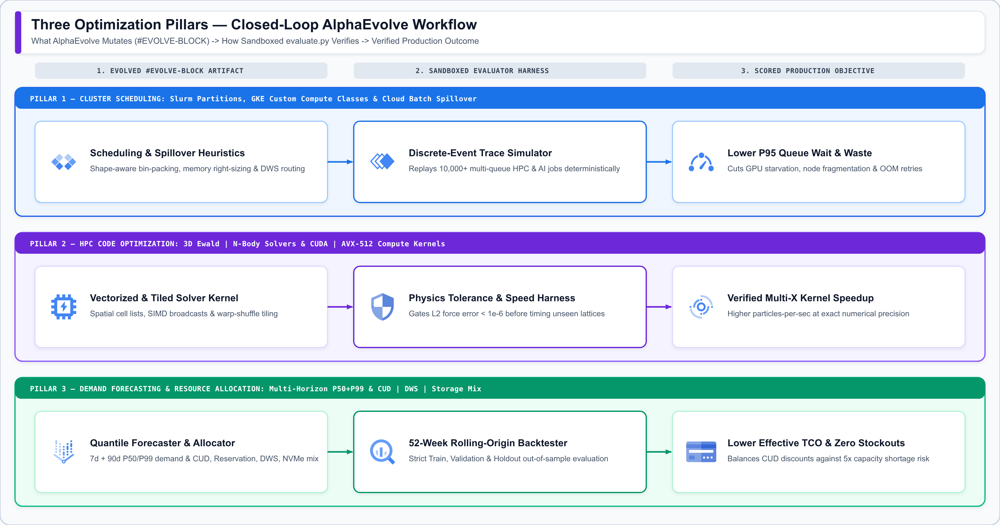
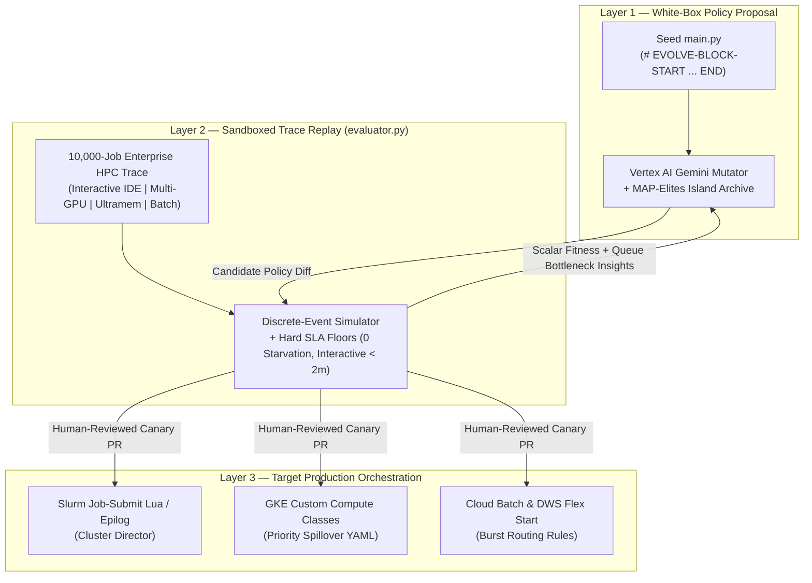
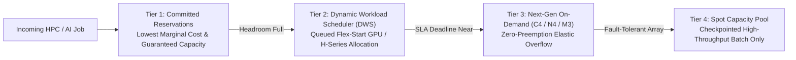

# Pillar 1 — Cluster Scheduling Optimization

> **Evolving white-box scheduling, shape-aware bin-packing, and multi-tier spillover policies across Slurm, GKE Custom Compute Classes, and Google Cloud Batch.**

<p align="center">
  
</p>

---

## 1. Operational Bottlenecks in Static Cluster Schedulers

| Common Pathology | Root Cause in Static Configurations | Operational & Cost Impact |
| :--- | :--- | :--- |
| **Node Shape Fragmentation** | Lightweight `2–8 vCPU` interactive or preprocessing jobs land on `64+ vCPU` Ultramem or multi-GPU nodes | Strands high-cost memory and GPU capacity |
| **Accelerator Queue Starvation** | Rigid FIFO / static fairshare priorities lack lookahead backfill across bursty multi-GPU arrivals | Multi-hour P95 queue wait times for researchers |
| **OOM & Timeout Cascades** | Uncalibrated user memory/walltime requests pass unguarded into execution queues | Wasted compute hours and repeated job retries |
| **Suboptimal Capacity Spillover** | Hardcoded partition thresholds ignore real-time Reservation headroom, DWS Flex Start wait, and Spot interruption risk | Excess On-Demand spend or unnecessary Spot preemptions |

---

## 2. Closed-Loop Policy Evolution Architecture

AlphaEvolve never mutates live production Slurm or Kubernetes daemons directly. Instead, it evolves a **pure, auditable Python policy constructor** offline against deterministic historical trace replay.



---

## 3. What AlphaEvolve Evolves vs. What Remains Fixed

| Layer | Component | Mutable by AlphaEvolve? | Purpose |
| :--- | :--- | :---: | :--- |
| **Mutable (`# EVOLVE-BLOCK`)** | Priority scoring & dynamic aging weights | **Yes** | Prevents GPU starvation while preserving interactive responsiveness |
| **Mutable (`# EVOLVE-BLOCK`)** | Shape-guardrail & bin-packing affinity rules | **Yes** | Isolates Ultramem and GPU nodes from small scalar jobs |
| **Mutable (`# EVOLVE-BLOCK`)** | Historical memory/runtime right-sizing envelope | **Yes** | Predicts safe P95 memory envelope to prevent OOM cascades |
| **Mutable (`# EVOLVE-BLOCK`)** | Multi-tier spillover thresholds | **Yes** | Routes bursts across `Reservations → DWS Flex Start → Gen-4 On-Demand → Spot` |
| **Immutable Harness** | `trace_generator.py` & `evaluator.py` | **No** | Deterministic Train / Holdout replay and hard SLA guardrails |

---

## 4. Multi-Tier Capacity Spillover Hierarchy



| Workload Profile | Target Compute Pool | Allowed Spillover Tiers | Storage Routing |
| :--- | :--- | :--- | :--- |
| **Interactive Workbench (IDE / Notebooks)** | General CPU / Single-GPU | `Reservation → On-Demand` *(Spot blocked)* | Low-latency home + cached datasets |
| **Multi-GPU Distributed Training** | Multi-GPU Accelerator Pool | `Reservation → DWS Flex Start` | High-IOPS NVMe Parallel FS scratch |
| **High-Memory Genomics / Analytics** | Ultramem CPU Pool | `Reservation → On-Demand` *(Small scalar jobs blocked)* | High-IOPS NVMe scratch + Object Lakehouse |
| **Checkpointed Batch Arrays** | Elastic Throughput Pool | `Reservation → Spot → DWS Flex Start` | Cloud Storage Lakehouse streaming |

---

## 5. Validated Held-Out Benchmark Results (`Vertex AI gemini-2.5-flash`, Gen 10 Winner)

| Metric | Naive FIFO (`Seed`) | Tuned Fairshare | AlphaEvolve Winner | Verified Delta |
| :--- | :---: | :---: | :---: | :---: |
| **Composite `overall_score`** | `-344.87` | `-174.82` | **`-63.61`** | **`+81.55%`** |
| **GPU Training P95 Queue Wait** | `572.76 min` | — | **`1.25 min`** | **`-99.8%`** |
| **Interactive IDE P95 Startup** | `8.0 s` | — | **`8.0 s`** | `< 120.0 s` SLA Floor |
| **Avg Compute + Storage Cost / Job** | `$4.08` | — | **`$2.39`** | **`-41.3%`** |
| **OOM + Timeout + Preemption Rate** | `45.55%` | — | **`0.05%`** | **`-99.9%`** |

---

## 6. Running Pillar 1 Locally & on Cloud Batch

```bash
# 1. Run Pillar 1 unit & anti-reward-hacking SLA gate tests
pytest tests/test_pillar1_cluster_scheduling.py -v

# 2. Run evolutionary search (deterministic offline replay or live Vertex AI mode)
export GCP_PROJECT_ID="<YOUR_GCP_PROJECT_ID>"
export GCP_REGION="us-central1"
python3 -m pillars.common.evolution_runner --mode live --pillar cluster_scheduling --candidates 14
```
