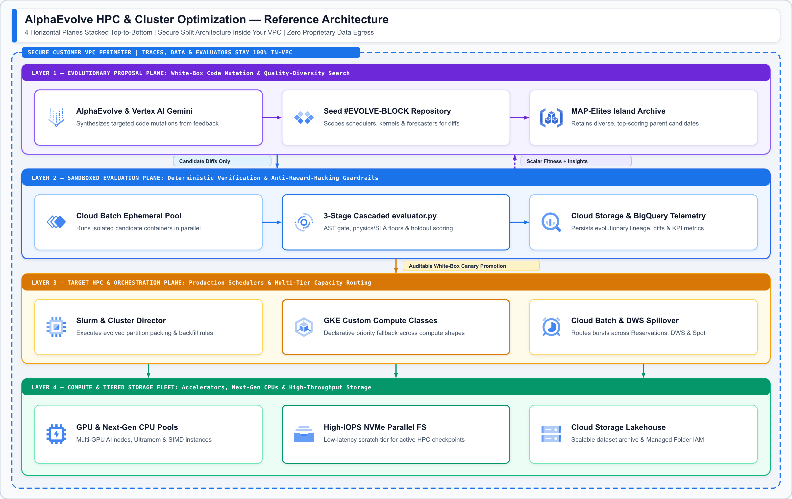
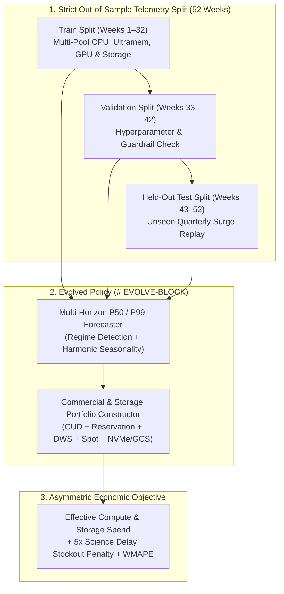

# Pillar 3 — Demand Forecasting & Resource Allocation

> **Evolving multi-horizon P50/P99 cluster capacity forecasters and asymmetric CUD, Reservation, DWS Flex Start, Spot, and tiered storage allocators.**

<p align="center">
  
</p>

---

## 1. Why Static Capacity Spreadsheets Underperform

| Planning Challenge | Static Spreadsheet / Moving-Average Heuristic | AlphaEvolve Evolved Constructor |
| :--- | :--- | :--- |
| **Asymmetric Business Risk** | Symmetric RMSE treats under-provisioning and idle buffer equally | Optimizes directly against **5x asymmetric stockout penalty** vs. idle headroom cost |
| **Multi-Horizon Seasonality** | Fixed `+20%` buffer misses quarterly R&D milestones and weekday/weekend cycles | Jointly forecasts **7-day tactical** and **90-day quarterly** P50/P99 quantiles |
| **Commercial Mix Coupling** | Fixed `50%` commitment split across all pools regardless of burstiness | Pool-specific mix across **1Y/3Y CUDs, Reservations, DWS Flex Start, On-Demand & Spot** |
| **Storage Tier Drift** | Leaves cold checkpoints on expensive High-IOPS NVMe Parallel FS | Dynamically shifts warm/cold datasets between **NVMe Scratch** and **Cloud Storage Lakehouse** |

---

## 2. Rolling-Origin Backtesting & Allocation Loop



---

## 3. Commercial Assurance & Storage Portfolio Levers

| Resource Tier | Commercial / Technical Mechanism | Ideal Workload Horizon | Cost & Availability Trade-off |
| :--- | :--- | :--- | :--- |
| **Base-Load Floor** | **1Y / 3Y Resource & Flexible CUDs** | Steady year-round P25–P50 baseline | Highest discount (`28%–55%`); continuous commitment |
| **Peak Assurance** | **Targeted Zonal Reservations** | High-priority interactive & milestone GPU runs | Guaranteed physical obtainability when needed |
| **Queued Accelerator Burst** | **Dynamic Workload Scheduler (DWS Flex Start)** | Asynchronous multi-GPU training & batch sweeps | Discounted accelerator access with bounded queue start |
| **Elastic Spillover** | **Next-Gen On-Demand & Spot VMs** | Short spiky bursts & checkpointed batch arrays | Zero long-term lock-in; Spot requires fault-tolerant retry |
| **Tiered HPC Storage** | **High-IOPS NVMe Parallel FS ↔ Cloud Storage** | Active solver scratch (`NVMe`) vs. curated datasets (`GCS`) | Prevents metadata contention and reduces `/scratch` footprint |

---

## 4. Anti-Overfitting & Leakage Guardrails

| Guardrail | Enforcement in `evaluator.py` |
| :--- | :--- |
| **Causal Masking (Zero Lookahead)** | At week $t$, candidate code receives strictly `history[:t]` — future demand slices are physically withheld |
| **Non-Negative & Portfolio Conservation** | Allocated capacity across `CUD + Reservation + DWS + On-Demand + Spot` must be finite, non-negative, and respect Spot share caps |
| **P99 SLA Coverage Floor** | Candidates exceeding maximum allowable stockout frequency fail Stage 2 (`-1e12`) |
| **Held-Out Generalization** | Final benchmark reporting uses strictly unseen **Held-Out Test** weeks |

---

## 5. Validated Held-Out Benchmark Results (`Vertex AI gemini-2.5-flash`, Gen 12 Winner)

| Held-Out Backtest Metric (Weeks 40–51) | Moving-Average (`Seed`) | AlphaEvolve Winner | Verified Delta |
| :--- | :---: | :---: | :---: |
| **Primary Backtest Score (`overall_score`)** | `-4,812.67` | **`-3,329.25`** | **`+30.82%`** |
| **Total Risk-Adjusted 12-Week TCO** | `$4,697.70K` | **`$3,261.19K`** | **`-30.6%` (`-$1,436.5K`)** |
| **Asymmetric 5x Stockout Penalty** | `$1,044.00K` | **`$21.73K`** | **`-97.9%`** |
| **Daily P99 Stockout Breach Rate** | `54.76%` | **`5.36%`** | **`-49.4 pts`** |
| **Blended Multi-Horizon WMAPE (`7d + 90d`)** | `13.53%` | **`8.01%`** | **`-40.8%`** |

---

## 6. Running Pillar 3 Locally

```bash
# 1. Run Pillar 3 rolling-origin backtest & causal leakage guardrails
pytest tests/test_pillar3_demand_forecasting.py -v

# 2. Run evolutionary search (offline replay or live Vertex AI mode)
export GCP_PROJECT_ID="<YOUR_GCP_PROJECT_ID>"
export GCP_REGION="us-central1"
python3 -m pillars.common.evolution_runner --mode live --pillar demand_forecasting --candidates 14
```
