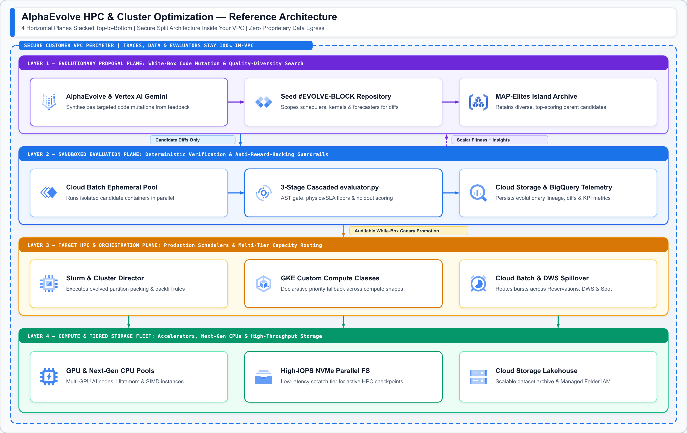
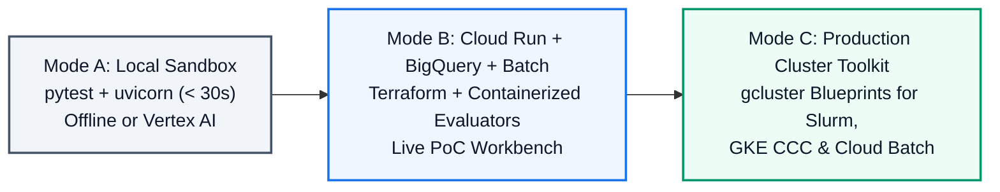

# Google Cloud Deployment Guide

> **Deploy the Interactive AlphaEvolve HPC Workbench on Cloud Run, provision telemetry in BigQuery & Cloud Storage via Terraform, and run isolated candidate evaluations on Google Cloud Batch & Cluster Toolkit (`gcluster`).**

<p align="center">
  
</p>

---

## 1. Deployment Topologies at a Glance



| Deployment Mode | Prerequisites | Provisioned Components | Typical Setup Time |
| :--- | :--- | :--- | :---: |
| **Mode A — Local Quickstart** | Python `3.11+` | Local 3-pillar evaluators, unit tests & FastAPI Workbench on `:8080` | `~1 min` |
| **Mode B — Live Cloud PoC** | `gcloud`, `terraform >= 1.5`, GCP Project | Cloud Run Workbench, BigQuery telemetry dataset, GCS archive, Cloud Batch evaluator job | `~5 min` |
| **Mode C — Cluster Toolkit (`gcluster`)** | Cluster Toolkit CLI + Quota | Slurm / Cluster Director with DWS spillover, GKE Custom Compute Classes & Batch pool | `~15–25 min` |

---

## 2. Mode A — Local Sandbox & Interactive Workbench

```bash
# 1. Install dependencies & run full verification suite
python3 -m venv .venv && source .venv/bin/activate
pip install -r requirements.txt
pytest -v

# 2. Launch the Interactive HTML5 + FastAPI Workbench locally
uvicorn app.server:app --host 0.0.0.0 --port 8080
```

> **Optional Live Vertex AI Mutation Locally**: Export `GCP_PROJECT_ID="<YOUR_GCP_PROJECT_ID>"` and `GCP_REGION="us-central1"` with Application Default Credentials (`gcloud auth application-default login`) to enable live `gemini-2.5-flash` `# EVOLVE-BLOCK` mutations via `/api/evolve-step`.

---

## 3. Mode B — Terraform, BigQuery, Cloud Batch & Cloud Run Deployment

### Step 1: Set Environment Variables & Enable APIs

```bash
export GCP_PROJECT_ID="<YOUR_GCP_PROJECT_ID>"
export GCP_REGION="us-central1"

gcloud services enable \
  aiplatform.googleapis.com \
  batch.googleapis.com \
  bigquery.googleapis.com \
  cloudbuild.googleapis.com \
  run.googleapis.com \
  artifactregistry.googleapis.com \
  storage.googleapis.com \
  --project="${GCP_PROJECT_ID}"
```

### Step 2: Provision Core Infrastructure via Terraform

```bash
terraform -chdir=infra/terraform init
terraform -chdir=infra/terraform validate
terraform -chdir=infra/terraform apply \
  -var="project_id=${GCP_PROJECT_ID}" \
  -var="region=${GCP_REGION}"
```

| Provisioned Resource | Purpose |
| :--- | :--- |
| **Cloud Storage Archive Bucket** | Stores seed `# EVOLVE-BLOCK` programs, candidate diffs, and Cloud Batch evaluation outputs |
| **BigQuery Dataset (`alphaevolve_hpc_poc`)** | Stores `evolution_runs`, `candidate_evaluations`, and `cluster_replay_metrics` |
| **Artifact Registry Repository** | Hosts immutable container images for the Workbench and Cloud Batch evaluators |
| **Least-Privilege Service Accounts** | Scoped IAM roles for isolated Cloud Batch workers and Cloud Run service |
| **Cloud Run Service (`alphaevolve-hpc-workbench`)** | Serverless HTTPS UI + REST API for interactive simulation and live Vertex AI mutations |

### Step 3: Build & Deploy Cloud Run, Seed BigQuery & Submit Cloud Batch Job

```bash
# 1. Build container image & deploy the Interactive Workbench to Cloud Run
./scripts/deploy_cloud_run.sh

# 2. Seed BigQuery telemetry tables (evolution_runs, candidate_evaluations, cluster_replay_metrics)
python3 scripts/seed_bigquery.py

# 3. Submit & verify an isolated Google Cloud Batch 3-pillar evaluation job
python3 scripts/submit_cloud_batch_job.py
```

---

## 4. Mode C — Production HPC Blueprints (`infra/cluster-toolkit/`)

The `infra/cluster-toolkit/` directory provides declarative blueprints aligning AlphaEvolve's evaluation plane with production HPC orchestrators:

| Blueprint File | Orchestrator | Key Architectural Pattern |
| :--- | :--- | :--- |
| `alphaevolve-hpc-batch.yaml` | **AlphaEvolve + Cloud Batch** | Ephemeral sandboxed evaluation pool reading `# EVOLVE-BLOCK` candidates from GCS |
| `hpc-slurm-dws-spillover.yaml` | **Slurm / Cluster Director** | Dedicated interactive, Ultramem & multi-GPU partitions with `Reservation → DWS Flex Start → Spot` spillover |
| `gke-custom-compute-class.yaml` | **GKE Custom Compute Classes** | Declarative `ComputeClass` priority list cascading across reserved accelerators, DWS Flex Start, and Gen-4 nodes |

```bash
# Validate & render a Cluster Toolkit blueprint before deployment
gcluster create infra/cluster-toolkit/hpc-slurm-dws-spillover.yaml \
  --vars "project_id=${GCP_PROJECT_ID},region=${GCP_REGION}" \
  -o deployment/
```

---

## 5. Security & VPC Data-Isolation Checklist

- **Zero Raw Data Egress**: Historical job traces, molecular structures, and capacity telemetry reside strictly inside your VPC's Cloud Storage and BigQuery resources; only compact source-code diffs and scalar fitness diagnostics cross the proposal boundary.
- **Ephemeral Non-Root Evaluators**: Each `evaluator.Dockerfile` runs as UID `1000` inside an isolated Cloud Batch container with AST/syscall guardrails.
- **Human-in-the-Loop Canary Promotion**: Evolved heuristics and kernels are exported as standard, diffable Python/CUDA pull requests validated in shadow mode prior to production rollout.
