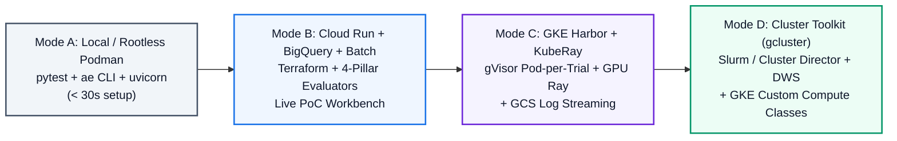

# Google Cloud Deployment Guide

> **Deploy the 4-Pillar Interactive AlphaEvolve HPC & Harbor Workbench on Cloud Run, connect to Managed AlphaEvolve (`GE_APP_ID`), provision BigQuery & Cloud Storage via Terraform, and scale isolated evaluators across Cloud Batch, GKE Harbor/KubeRay, Cluster Toolkit (`gcluster`), or Rootless Podman.**

<p align="center">
  
</p>

---

## 1. Deployment Topologies at a Glance



| Deployment Mode | Prerequisites | Provisioned Components | Typical Setup Time |
| :--- | :--- | :--- | :---: |
| **Mode A — Local & `ae` Skills** | Python `3.11+` (`uv`, optional `podman`) | Local 4-pillar evaluators, `ae` skills & FastAPI Workbench on `:8080` | `~1 min` |
| **Mode B — Live Cloud PoC** | `gcloud`, `terraform >= 1.5`, GCP Project | Cloud Run Workbench, BigQuery dataset, GCS archive & 4-pillar Cloud Batch job | `~5 min` |
| **Mode C — GKE Harbor & KubeRay** | GKE Autopilot / Standard Cluster | `gVisor` Harbor pod-per-trial pool, autoscaling GPU KubeRay & GCS log streaming | `~10 min` |
| **Mode D — Cluster Toolkit (`gcluster`)** | Cluster Toolkit CLI + Quota | Slurm / Cluster Director with DWS spillover & GKE Custom Compute Classes | `~15–25 min` |

---

## 2. Mode A — Local Sandbox, Rootless Podman & `alphaevolve-on-googlecloud` Skills

```bash
# 1. Install dependencies & run the full 4-pillar verification suite
python3 -m venv .venv && source .venv/bin/activate
pip install -r requirements.txt
pytest -v

# 2. Launch the Interactive HTML5 + FastAPI Workbench locally
uvicorn app.server:app --host 0.0.0.0 --port 8080
```

### Optional: Install the Official `ae` CLI, 6 AlphaEvolve Skills & Rootless Podman

```bash
# Install the official ae CLI and 6 coding-assistant skills from Google-Cloud-AI/alphaevolve-on-googlecloud
uv tool install "git+https://github.com/Google-Cloud-AI/alphaevolve-on-googlecloud.git#subdirectory=skills"
ae version
ae skills install

# On shared multi-user HPC login/workbench nodes, allocate distinct subuid/subgid ranges per user for rootless Podman:
sudo usermod --add-subuids 100000-165535 "$USER"
sudo usermod --add-subgids 100000-165535 "$USER"
```

### Connecting to Managed AlphaEvolve (`GE_APP_ID`) vs. Vertex AI Gemini

`pillars/common/managed_ae_client.py` supports both managed **Gemini Enterprise AlphaEvolve (`discoveryengine.googleapis.com`)** and direct **Vertex AI Gemini** mutation out of the box:

```bash
export GCP_PROJECT_ID="<YOUR_GCP_PROJECT_ID>"
export GCP_REGION="us-central1"

# Optional: set GE_APP_ID (and AE_LOCATION=global|us|eu) to use Managed AlphaEvolve Discovery Engine
export GE_APP_ID="<YOUR_GEMINI_ENTERPRISE_ENGINE_ID>"
export AE_BASE_URL="discoveryengine.googleapis.com"   # or eu-discoveryengine.googleapis.com / us-discoveryengine.googleapis.com
```

---

## 3. Mode B — Terraform, BigQuery, Cloud Batch & Cloud Run Deployment

### Step 1: Enable Required Google Cloud APIs

```bash
export GCP_PROJECT_ID="<YOUR_GCP_PROJECT_ID>"
export GCP_REGION="us-central1"

gcloud services enable \
  aiplatform.googleapis.com \
  discoveryengine.googleapis.com \
  batch.googleapis.com \
  bigquery.googleapis.com \
  cloudbuild.googleapis.com \
  container.googleapis.com \
  run.googleapis.com \
  artifactregistry.googleapis.com \
  storage.googleapis.com \
  --project="${GCP_PROJECT_ID}"
```

### Step 2: Provision Core Infrastructure via Terraform

```bash
terraform -chdir=infra/terraform init
terraform -chdir=infra/terraform validate
terraform -chdir=infra/terraform apply \
  -var="project_id=${GCP_PROJECT_ID}" \
  -var="region=${GCP_REGION}"
```

### Step 3: Deploy Cloud Run Workbench, Seed BigQuery & Submit 4-Pillar Cloud Batch Job

```bash
# 1. Build container image & deploy the 4-Pillar Interactive Workbench to Cloud Run
./scripts/deploy_cloud_run.sh

# 2. Seed BigQuery telemetry tables across all 4 pillars
python3 scripts/seed_bigquery.py

# 3. Submit & verify an isolated Google Cloud Batch 4-pillar evaluation job
python3 scripts/submit_cloud_batch_job.py
```

---

## 4. Mode C — GKE Harbor (`gVisor`) Pod-per-Trial + KubeRay GPU Evaluators

For Pillar 4 (**Agent Skill Optimization with Harbor**) and GPU-accelerated hyperparameter/kernel runs (`llm_fine_tuning` pattern), [`infra/gke-harbor-ray/harbor-skill-optimizer-gke.yaml`](../infra/gke-harbor-ray/harbor-skill-optimizer-gke.yaml) configures:
- **GKE Sandbox (`runtimeClassName: gvisor`)** isolating every Harbor agent trial in its own pod,
- **Concurrent Baseline + Candidate Execution** eliminating LLM latency-window score drift,
- **GCS / Cloud Logging Trial-Log Streaming + Bounded `emptyDir`** preventing local controller disk exhaustion during 10h+ evolutionary runs,
- **Autoscaling KubeRay GPU Worker Group** scaling down to `0` idle GPUs between runs.

```bash
# Validate & apply the GKE Harbor + KubeRay evaluation manifests
kubectl apply --dry-run=client -f infra/gke-harbor-ray/harbor-skill-optimizer-gke.yaml
```

---

## 5. Mode D — Production HPC Blueprints (`infra/cluster-toolkit/`)

| Blueprint File | Orchestrator | Key Architectural Pattern |
| :--- | :--- | :--- |
| `alphaevolve-hpc-batch.yaml` | **AlphaEvolve + Cloud Batch** | Ephemeral sandboxed evaluation pool reading `# EVOLVE-BLOCK` candidates from GCS |
| `hpc-slurm-dws-spillover.yaml` | **Slurm / Cluster Director** | Dedicated interactive, Ultramem & multi-GPU partitions with `Reservation → DWS Flex Start → Spot` spillover |
| `gke-custom-compute-class.yaml` | **GKE Custom Compute Classes** | Declarative `ComputeClass` priority list cascading across reserved accelerators, DWS Flex Start, and Gen-4 nodes |

```bash
# Render a Cluster Toolkit blueprint before deployment
gcluster create infra/cluster-toolkit/hpc-slurm-dws-spillover.yaml \
  --vars "project_id=${GCP_PROJECT_ID},region=${GCP_REGION}" \
  -o deployment/
```
