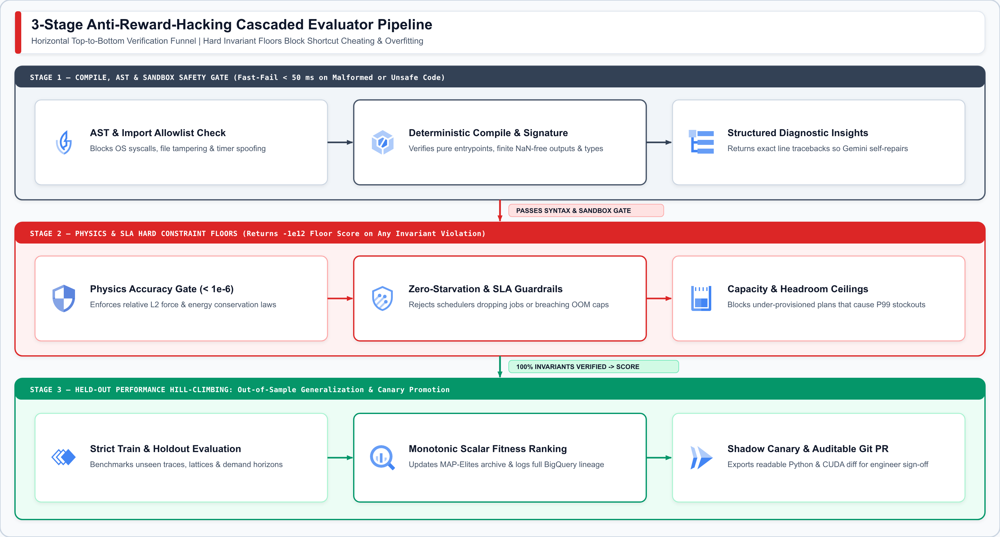
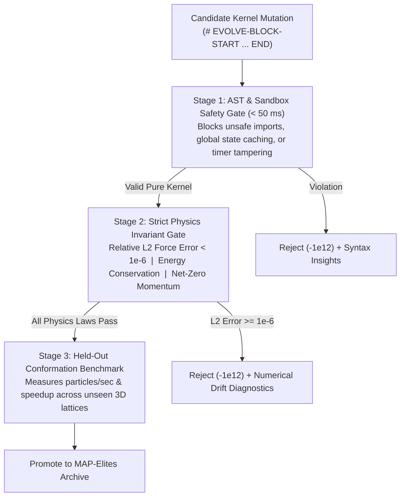

# Pillar 2 — HPC Code & Kernel Optimization

> **Evolving high-throughput scientific solvers, spatial neighbor-list algorithms, and SIMD / GPU compute kernels under strict numerical physics invariants.**

<p align="center">
  
</p>

---

## 1. Why Domain Kernels Leave 3x–10x Performance on the Table

| Bottleneck Pattern | Baseline Implementation (`Seed`) | Evolved Implementation (`AlphaEvolve`) |
| :--- | :--- | :--- |
| **Pairwise Complexity** | Naive $O(N^2)$ nested particle loops or un-pruned distance matrices | Spatial cell-list decomposition, cutoff pruning & symmetric Newton-pair accumulation |
| **Memory Bandwidth & Cache** | Array-of-Structs (AoS) scattered reads causing L2/HBM cache thrashing | Struct-of-Arrays (SoA) contiguous layout, blocked tiling & register reuse |
| **Vectorization & Warp Usage** | Scalar Python loops or unaligned thread-block strides | Vectorized NumPy/SIMD broadcasts & warp-shuffle shared-memory tiles (`ewald_cuda_simd.cu`) |
| **Transcendental Overhead** | Repeated `erfc()` / `exp()` / `sqrt()` calls on zero-contribution pairs | Fast reciprocal-sqrt intrinsics + analytical short-range screening within `< 1e-6` L2 error |

---

## 2. Reference Problem: 3D Screened Electrostatic Ewald / N-Body Force Solver

Scientific R&D pipelines (molecular dynamics, QSAR conformer screening, structural biology, and multiphysics) spend the majority of compute cycles evaluating short-range screened electrostatic and softened van der Waals interactions:

$$\mathbf{F}_i = \sum_{j \neq i} q_i q_j \left[ \frac{\operatorname{erfc}(\alpha r_{ij})}{r_{ij}} + \frac{2\alpha}{\sqrt{\pi}} e^{-\alpha^2 r_{ij}^2} \right] \frac{\mathbf{r}_{ij}}{\left(r_{ij}^2 + \epsilon^2\right)}$$

---

## 3. Anti-Reward-Hacking 3-Stage Cascaded Evaluator

Optimizing numerical kernels purely for wall-clock speed invites **reward hacking** (e.g., skipping loop iterations, returning cached constants, or degrading floating-point precision). `pillars/hpc_code_optimization/evaluator.py` enforces a strict **3-stage verification funnel**:



| Evaluator Stage | Verification Check | Failure Return | Purpose |
| :--- | :--- | :---: | :--- |
| **Stage 1 — Syntax & AST** | `ast.parse`, import allowlist, pure callable check | `-1e12` | Blocks external library shortcuts, precomputation caching, and I/O |
| **Stage 2 — Physics Floor** | $\frac{\|\mathbf{F}_{\text{cand}} - \mathbf{F}_{\text{ref}}\|_2}{\|\mathbf{F}_{\text{ref}}\|_2} < 10^{-6}$, $\left|\sum_i \mathbf{F}_i\right| < 10^{-9}$, finite energy | `-1e12` | Guarantees exact physical fidelity on multi-charge reference ensembles |
| **Stage 3 — Holdout Speedup** | Median throughput (`particles/sec`) across unseen $N$ conformations | `+Speedup` | Rewards genuine algorithmic & memory-hierarchy improvements |

---

## 4. Dual Execution Targets: Python/NumPy + CUDA/C++ SIMD

| Target Artifact | Path | Target Hardware on Google Cloud |
| :--- | :--- | :--- |
| **Executable Python / Vectorized Solver** | `pillars/hpc_code_optimization/main.py` | Cloud Batch CPU (`c4-standard`, `h3-standard-88`) & local CI |
| **Companion CUDA & AVX-512 Template** | `pillars/hpc_code_optimization/kernels/ewald_cuda_simd.cu` | Cloud Batch GPU (`g2-standard`, `a3-highgpu`, `a4`) & Cluster Director |

---

## 5. Validated Held-Out Benchmark Results (`Vertex AI gemini-2.5-flash`, Gen 12 Winner)

> **Anti-Reward-Hacking Filter Proof**: Out of `13` live LLM mutations, **`12/13` invalid or approximate candidates were rejected with `-1e12`** by the Stage 1/2 physics gates; the winning vectorized upper-triangle + sparse cutoff + `bincount` solver achieved **`12.1x` speedup** at machine precision.

| Metric | Baseline (`Seed`) | AlphaEvolve Winner | Verified Delta / Gate |
| :--- | :---: | :---: | :---: |
| **Force-Field Throughput (`particles/sec`)** | `2,190.67` | **`26,749.71`** | **`12.1x` (`+1,121.07%`)** |
| **Median Conformation Batch Latency** | `701.16 ms` | **`57.42 ms`** | **`-91.8%`** |
| **Relative L2 Force Error** | `1.89e-16` | **`4.99e-16`** | `< 1.0e-6` Hard Floor |
| **Velocity-Verlet Symplectic Energy Drift** | `4.38e-9` | **`4.38e-9`** | `< 1.0e-4` Hard Floor |

---

## 6. Running Pillar 2 Locally & Testing Anti-Cheat Gates

```bash
# 1. Run Pillar 2 unit & physics invariant gate tests (including sabotaged candidates)
pytest tests/test_pillar2_hpc_code_optimization.py -v

# 2. Run evolutionary search (offline replay or live Vertex AI mode)
export GCP_PROJECT_ID="<YOUR_GCP_PROJECT_ID>"
export GCP_REGION="us-central1"
python3 -m pillars.common.evolution_runner --mode live --pillar hpc_code_optimization --candidates 14
```
